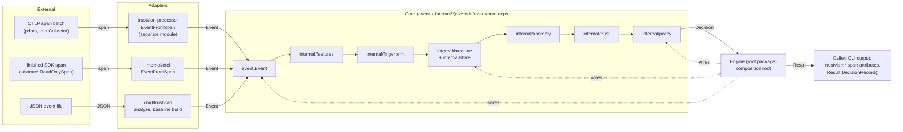
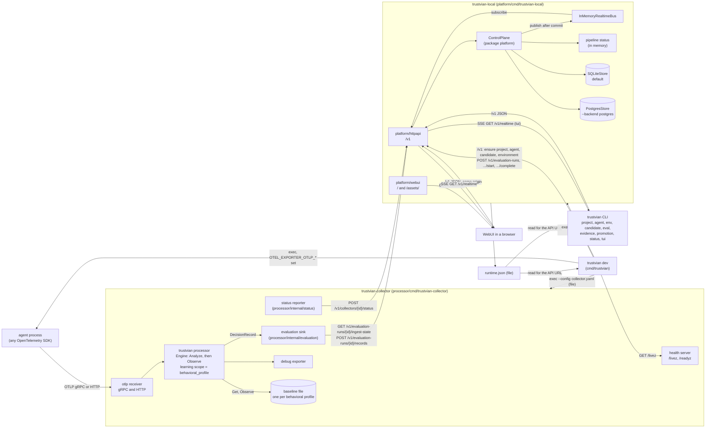
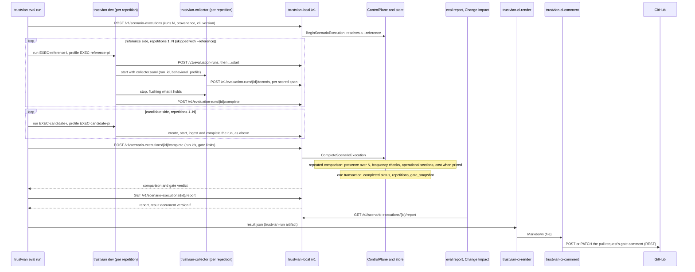
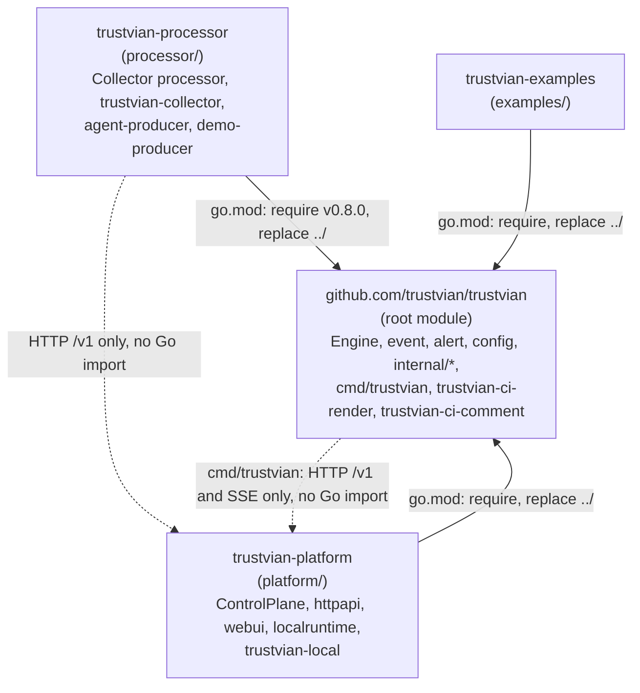

# Architecture

Trustvian is a single-tenant Go engine built as a hexagonal core (`event` +
`internal/*`) wrapped by a thin composition root (`Engine`, root package),
plus two layers built on its public API in modules of their own: the
OpenTelemetry Collector processor (`processor/`) and the control plane
(`platform/`). The [module boundary](#the-four-modules) section shows how
the four modules depend on each other. This document explains the system's
shape; see
[DOMAIN.md](DOMAIN.md) for what each pipeline stage's data actually
means, [SECURITY.md](SECURITY.md) for the threat model, and
[PERFORMANCE.md](PERFORMANCE.md) for measured hot-path behavior.
Significant decisions behind this shape are recorded as ADRs in
[`adr/`](adr/). What's planned to change this shape next — and in what
order — is in [ROADMAP.md](ROADMAP.md) and [`tasks/`](tasks/).

## System diagram



Drawn from `engine.go`, `internal/otel/otel.go`, `processor/mapping.go`, `cmd/trustvian/analyze.go`, `cmd/trustvian/baseline.go` at v0.12.0.

Dotted edges are composition (`Engine` constructs and holds these), not
data flow. Nothing under `core` imports `adapters`, `Engine`, or each
other except strictly downward along the pipeline — see
[Dependency direction](#dependency-direction).

Two adapters turn an OpenTelemetry span into an `Event`, one per data model.
The Collector processor maps a pdata span inside `trustvian-collector`; that is
where the engine runs in a deployment and under `trustvian dev`. `internal/otel`
maps a finished SDK span. It is internal, so only this module can call it, and
only its own tests do. Both read one convention table, `internal/semconv`:
`internal/otel` imports it, and the processor, which cannot reach `internal/`,
calls it through `event.NormalizeSpan`.

## The pipeline

Every event flows through the same seven stages, in the same order:

```
Event → Features → Fingerprint → Baseline(read) → Anomaly → Trust → Policy → Decision
                                       ↑
                              Baseline(write) via explicit Observe()
```

| Stage | Package | Input → Output |
|---|---|---|
| Features | `internal/features` | `event.Event` → `Features` (stable + volatile dimensions) |
| Fingerprint | `internal/fingerprint` | `Features.Stable` → a deterministic `Fingerprint.ID` |
| Baseline | `internal/baseline`, `internal/store` | statistical history per `(Scope, ActorID, Environment, Fingerprint)` |
| Anomaly | `internal/anomaly` | `Features` + `Baseline` → `Anomaly{Score, Confidence, Contributors}` |
| Trust | `internal/trust` | `Anomaly` + identity + context → `Trust{Score, Risk}` |
| Policy | `internal/policy` | `Trust` + `Features.Stable` → `Decision` + `Explanation` |

`Engine` (the root `trustvian` package) is the composition root that
wires all of this together — see [`engine.go`](../engine.go).

[Task 001](archive/tasks/v0.1/001-feature-model.md) added `event.Target.Category`
and `features.StableFeatures.TargetCategory` — a new field on existing
types, not a new package or dependency edge, so no change to the
pipeline shape or [dependency direction](#dependency-direction) below.

**A human, a service, and an AI agent are all just `Actor.Type` values
flowing into the exact same pipeline above** — never a second
pipeline. `ActorTypeAIAgent` (`v0.1`) and, since `v0.7` ([task
014](archive/tasks/v0.7/014-ai-agent.md), [ADR
0014](adr/0014-ai-agents-as-first-class-behavioral-actors.md)),
`event.Context`'s `SessionID`/`DelegatedFrom`/`ApprovalStatus` fields
are additive `Event`/`Context` fields, not a parallel `AgentEngine`,
`AgentAnomalyEngine`, or agent-specific `Fingerprint`/`Baseline`/
`Anomaly` type. An AI agent's tool-call sequence is scored by the
identical `internal/anomaly` signals (including every `v0.6` sequence
signal) any other actor's operation sequence would be — proven, not
merely asserted, by `TestAnalyzeAgentToolSequenceNoveltyDetectedByExistingEngine`
in [`engine_test.go`](../engine_test.go). Task
[030](archive/tasks/v0.7/030-approval-aware-policy-semantics.md) and
[031](archive/tasks/v0.7/031-delegation-behavioral-semantics.md) hold the identical
line: approval-aware policy is one more `policy.Condition` field, and
delegation novelty is one more bounded map on `Baseline`
(`DelegatorCounts`, alongside `PredecessorCounts`/`TrigramCounts`) and
one more opt-in `internal/anomaly` signal — never a second
engine, a `DelegationGraph`, or an `ApprovalPolicyEngine`. See [ADR
0015](adr/0015-approval-as-policy-evidence-not-behavioral-anomaly.md)
and [ADR
0016](adr/0016-delegation-as-behavioral-evidence-not-provenance.md).

Every stage but `Baseline` is a pure function. `Baseline` is
immutable-value-with-copy-on-write: `Baseline.Observe(...)` never
mutates its receiver, it returns a new `Baseline`. Concurrency-safe
storage of "the current `Baseline` for this key" is `internal/store`'s
job — it shards a lock per `(Scope, ActorID, Environment)` key so unrelated
actors never contend with each other.

## Analyze is read-only; Observe is the only write path

```go
result, err := engine.Analyze(ctx, ev)   // never touches the Baseline
learned, err := engine.Observe(ctx, result) // conditionally learns
```

`Observe` decides for itself whether `result` is safe to learn from —
see [Go SDK Guide § Observe and learning](sdk-guide.md#observe-and-learning)
and [Policy Guide § fail-closed, not fail-open](policy-guide.md#fail-closed-not-fail-open).
Callers never need to check `result.Decision` themselves before calling
`Observe`; it's always safe to call unconditionally.

## Cold start: two numbers, not one

A brand-new `Fingerprint` (an actor doing something Trustvian has never
seen it do before) scores as maximally novel —
`Anomaly.Score` near 1 — but with `Anomaly.Confidence` at 0.
`internal/anomaly` deliberately does not suppress `Score` for a novel
fingerprint: collapsing "how different is this" and "how much should
you trust that reading" into a single number would throw away
information a security decision needs.

The two are recombined in `internal/trust`:

```
effectiveAnomaly = Anomaly.Score * Anomaly.Confidence
TrustScore        = IdentityConfidence * (1 - effectiveAnomaly) * (1 - ContextRisk)
```

At `Confidence = 0`, `effectiveAnomaly` is 0 regardless of how novel the
event looks, so `TrustScore` falls back to identity and context alone.
This is why a first-ever, high-identity-confidence event doesn't get
blocked just for being new — see the walkthrough in
[Use Cases](use-cases.md) and the SDK example in
[Go SDK Guide § baseline maturity](sdk-guide.md#watching-trust-mature).

## Package boundaries

Four packages are importable from outside this module: the root
`trustvian` package, `event`, `alert` (`v0.4.0`), and `config`
(`v0.5`, [task 019](archive/tasks/v0.5/019-policy-config-model.md)). Everything
else lives under `internal/`, which Go's compiler enforces.

```
trustvian/
├── trustvian.go, engine.go, options.go, result.go   # public: Engine, Option, Result
├── event/                                              # public: Event, Actor, Operation, Target, Context
├── alert/                                              # public: Alert, Severity, Condition/Rule/Evaluate, Sink, WebhookSink
├── config/                                             # public: PolicyConfig/Rule/Condition, CompilePolicy
├── cmd/trustvian/                                       # CLI (in-module, can import internal/*)
├── cmd/trustvian-ci-render/                             # CI artifact → Markdown, through internal/cirender (ADR 0057)
├── cmd/trustvian-ci-comment/                            # Markdown → the PR's one gate comment (stdlib only; ADR 0058)
├── examples/                                           # separate module: genuinely-external-consumer demos
├── platform/                                           # separate module: control plane, trustvian-local, WebUI
├── processor/                                          # separate module: Collector processor, trustvian-collector
└── internal/
    ├── features/    fingerprint/    baseline/    store/    store/postgres/
    ├── anomaly/     trust/          policy/
    ├── semconv/                                         # the agent-oriented convention table; imports nothing
    ├── buildinfo/                                       # version and revision of the running binary
    ├── cirender/                                        # result document → Markdown, for eval report and trustvian-ci-render
    └── otel/                                            # the ONLY package that imports go.opentelemetry.io/otel*
```

**Why `event`/`alert`/`config` sit outside `internal/`, while
`Decision`/`Policy`/most `Config` types stay under it.** Go's
`internal/` restriction only blocks *importing* a package — it does
not block reading exported fields off a value you already have, or
receiving and forwarding a value of that type via type inference
without ever spelling out its type name. `result.Trust.Score` and
`result.Decision == "block"` both work fine from external code
without importing anything beyond the root package, and (verified
empirically — see [ADR 0008](adr/0008-policy-config-boundary.md)) so
does receiving a `policy.Policy` from an exported function and passing
it straight into `trustvian.WithPolicy`. So the types that must move
out are only the ones an external caller must *construct by name* —
declare a variable of that type, or implement an interface using it in
a method signature:

- `event.Event` — the one type every caller must construct just to
  call `Engine.Analyze` at all.
- `alert.Alert`/`alert.Sink` — a third-party `Sink` implementation
  must name `Alert` in its own method signature to implement the
  interface at all; no amount of pass-through helps here, since
  *implementing* an interface (not just calling a function) requires
  naming the type (see [ADR 0007](adr/0007-alert-package-is-public.md)).
- `config.PolicyConfig`/`PolicyRule`/`PolicyCondition` — an external
  caller must construct one (by hand, or via `config.LoadFile`) to
  express custom policy behavior at all.
- `config.AnomalyConfig` (`v0.7` task 033) — the identical pattern,
  one stage earlier in the pipeline: an external caller constructs
  this to configure behavioral scoring, never
  `internal/anomaly.Config` directly.
- `config.StorageConfig` (`v0.8` task 034) — the same pattern again,
  for persistence. `store.Store` is the one case where pass-through
  alone was *not* enough even in principle: it is an interface whose
  methods reference internal types, so an external caller could neither
  name it nor implement it, and before task 034 no exported function
  returned one. `WithStore` was therefore in-module-only in practice,
  silently pinning every external deployment to the in-memory default.
  Task 035 added `PostgresStorageConfig` to the same document, so
  selecting a production database is a YAML edit rather than a new
  mechanism. See [ADR
  0018](adr/0018-production-store-boundary-and-postgresql-direction.md).

`policy.Policy`/`Condition`/`Rule`/`Decision`, `anomaly.Config`,
`trust.Config`, and `store.Store` implementations all stay
`internal/`: no external caller needs to *construct* any of them by
name. `config.CompilePolicy`, `config.CompileAnomaly` and
`config.CompileTrust` are the exported functions that produce a
`policy.Policy`, `anomaly.Config` and `trust.Config` for pass-through use — the
identical boundary [ADR
0008](adr/0008-policy-config-boundary.md) established for Policy in
`v0.5`, extended to Anomaly configuration by [ADR
0017](adr/0017-public-anomaly-configuration-boundary.md) in `v0.7`:

```text
config.PolicyConfig  → CompilePolicy  → policy.Policy   → Engine
config.AnomalyConfig → CompileAnomaly → anomaly.Config   → Engine
config.TrustConfig   → CompileTrust   → trust.Config     → Engine
config.StorageConfig → CompileStorage → store.Store      → Engine
```

`CompileStorage` is the one of these that is deliberately *not*
pure — it opens the store, so a load failure surfaces at construction
rather than on the first `Observe`. All of them fail closed; for storage
that specifically means a nil `Store` on any error, never a silent
downgrade to non-durable storage. See [Go SDK Guide § configuring from
outside the module](sdk-guide.md#configuring-from-outside-the-module).

**Why `internal/otel` is the only package that imports OpenTelemetry.**
The core engine (`event` through `internal/policy`, and `Engine`
itself) has zero OpenTelemetry dependency. The OTel Collector
processor ([`processor/`](../processor/), `v0.2`) is implemented as a
separate module — it needs the heavier `otelcol-builder`-adjacent
toolchain — so that dependency tree never touches the core engine's;
`go list -deps` on this module's own root confirms `processor/`'s
existence changes nothing here.

**Since task 075 that claim is checked rather than asserted.**
`scripts/check-platform-boundary.sh` runs `go list -deps` over `event`,
`internal/semconv`, `internal/features` through `internal/policy`,
`internal/store` and the root package, and fails the build if any
`go.opentelemetry.io/` package appears — paired with a check that
`internal/otel` *does* still import one, so the first cannot pass
vacuously because somebody moved the adapter.

That task is also why the check earns its keep. It added
`internal/semconv`, a package whose entire value is that it reads
OpenTelemetry *conventions* without importing OpenTelemetry — a property
one careless import would silently destroy. See
[ADR 0045](adr/0045-conventions-are-read-frameworks-are-not.md).

## Dependency direction

Verified directly, not asserted — `go list -deps` on every package:

```
internal/semconv     → (stdlib only)   ← the convention table; no OTel import
event                → internal/semconv
internal/features    → event
internal/fingerprint → internal/features
internal/baseline    → internal/features, internal/fingerprint
internal/store       → internal/baseline, internal/features, internal/fingerprint
internal/store/postgres → internal/{baseline,features,fingerprint}   (+ github.com/jackc/pgx/v5)
internal/anomaly     → internal/baseline, internal/features, internal/fingerprint
internal/trust       → internal/anomaly
internal/policy      → event, internal/features, internal/trust
trustvian (root)     → event, internal/{anomaly,baseline,features,fingerprint,policy,store,trust}
internal/otel        → trustvian (root), event, internal/features, internal/semconv   (+ go.opentelemetry.io/otel*)
alert                → trustvian (root), event, internal/policy, internal/trust
config               → alert, event, internal/{anomaly,policy,store,store/postgres,trust}   (+ go.yaml.in/yaml/v3)
internal/buildinfo   → (stdlib only)
internal/cirender    → (stdlib only)   ← the one renderer of result documents
cmd/trustvian        → trustvian (root), config, event, internal/{buildinfo,cirender,policy,trust}   (+ bubbletea, golang.org/x/sys)
cmd/trustvian-ci-render  → internal/cirender   ← reads the run artifact as data
cmd/trustvian-ci-comment → (stdlib only)       ← the only code that writes to GitHub; imports nothing in this module
```

Every pipeline edge points strictly toward an earlier stage or a leaf
(`event`, `internal/semconv`). Only the adapters `internal/otel` and
`alert` import the root package, and nothing imports `cmd/`, so there is no
cycle. Each third-party dependency is confined to one package:
OpenTelemetry to `internal/otel`, pgx to `internal/store/postgres`, YAML to
`config` (and the test-only `scripts` package), and the terminal UI and
`golang.org/x/sys` to `cmd/trustvian`. The root package and `cmd/trustvian`
are the only ones that assemble the pipeline stages together.

`internal/semconv` is a leaf like `event`: it holds the agent-oriented
convention table and imports nothing at all. `event` re-exports it as
`event.NormalizeSpan` so the Collector processor — a separate module,
which cannot reach `internal/` — calls the same table rather than
carrying a second copy of it.

## Storage boundary

`internal/store.Store` is the only seam between the pipeline and how
`Baseline` data is held:

```go
type Store interface {
	Get(ctx context.Context, key baseline.Key) (baseline.Baseline, bool)
	Observe(ctx context.Context, key baseline.Key, fp fingerprint.Fingerprint, vol features.VolatileFeatures, now time.Time) (baseline.Baseline, error)
}
```

Two methods, matching `Baseline`'s actual access pattern exactly — not
a generic repository. Three implementations exist:

- `store.InMemory` — baselines do not survive a process restart. Still
  the default.
- `store.FileStore` — a JSON file on disk, flushed synchronously after
  every `Observe`; baselines survive a restart, at the cost of `Observe`
  being roughly four orders of magnitude slower than against `InMemory`
  (see [PERFORMANCE.md](PERFORMANCE.md) and [ADR
  0006](adr/0006-file-backed-persistent-store.md)).
- `internal/store/postgres.Store` (`v0.8` task 035, hardened by task
  036) — shared, transactional persistence: one row per `baseline.Key`,
  `Observe` wrapped in a row-locked transaction, state readable by other
  processes. This is the backend that makes several Trustvian instances
  agree on one baseline instead of each holding its own.

  Three durable architectural properties, each verified rather than
  intended (task 036):

  - **Transaction boundary.** Exactly one transaction per `Observe`, and
    nothing outside `Observe` is ever inside one — not `Analyze`, not
    policy evaluation, not alert delivery. This is what keeps a database
    from sitting on the decision path.
  - **Same-key serialization.** `INSERT ... ON CONFLICT DO NOTHING` to
    materialize the row, then `SELECT ... FOR UPDATE` to lock it, at READ
    COMMITTED. Correctness comes from the explicit row lock, not from
    isolation level. Exactly one row is locked per transaction, so
    deadlock is structurally impossible and no lock-ordering discipline is
    required.
  - **Schema version boundary.** A recorded version that differs from the
    binary's `SchemaVersion`, or metadata that cannot be interpreted at
    all, fails startup closed. An older binary never mutates state whose
    layout it does not understand.

The PostgreSQL backend lives in its **own package**, not in new files
under `internal/store`, and that placement is the point: it is the only
package in this module allowed to import `github.com/jackc/pgx/v5`. This
is the same containment `internal/otel` applies to the OpenTelemetry SDK,
for the same reason — `internal/store` itself still uses nothing but
`encoding/json` and `os`.

Verified, not asserted: `go list -deps` reports zero pgx packages in the
dependency graph of `event`, `internal/features`, `internal/fingerprint`,
`internal/baseline`, `internal/anomaly`, `internal/trust`,
`internal/policy`, `internal/store`, **and the root `trustvian` package**.
Embedding the engine does not pull a database driver.

Where the driver *does* reach is `config`, because `config/compile.go`
holds `CompileStorage` — and therefore any consumer importing `config` for
*any* document, Policy included, links pgx transitively. The OTel
processor module is the concrete case: it imports `config` for policy
configuration and so acquires the driver it makes no use of. This is a
consequence of `CompileStorage` living in the same package as
`CompilePolicy` (task 034's boundary decision), not of the backend's
placement. It is recorded here as a known cost rather than described as
containment it does not have; splitting storage compilation into its own
public subpackage would resolve it and is a boundary change, not a
storage change.

Switching backends is a one-line `trustvian.WithStore(...)` change, or a
one-line edit to a `config.StorageConfig` document; every pipeline package
remains unaffected — none of them know `Store` exists, only `Engine` does,
and adding a third implementation did not change that. See
[storage-guide.md](storage-guide.md).

A separate, narrower `store.Freezer` interface (`Freeze`/`Unfreeze`/
`IsFrozen`) is implemented by `InMemory` and `FileStore` — a
per-`Key` capability to suspend learning without discarding history,
deliberately *not* part of `Store` itself, since `Engine` and every
pipeline package have no need to know it exists. Freeze state is never
persisted, even by `FileStore` — it's a live, current-process
operational flag, not learned behavioral history. The PostgreSQL store
deliberately does **not** implement `Freezer`: freeze is a per-process
concept, and one that silently applied to a single replica of a *shared*
store would misrepresent what it guaranteed.

`Freezer` is also the precedent for how `Close` was added. The PostgreSQL
store holds a connection pool and satisfies `io.Closer`; `Store` itself
gained no `Close` method, because only database-backed stores hold a
releasable resource and widening the port would have forced every
implementation and caller to change for a capability most do not need.
Callers type-assert (`if c, ok := s.(io.Closer); ok { defer c.Close() }`),
which is a no-op for the other two backends — the same optional-capability
shape, applied a second time rather than a new mechanism invented.

## Deployment topology

The reference deployment
([`deployments/docker-compose/`](../deployments/docker-compose/)) is the
engine's runtime shape on its own, with no control plane:

```text
   demo workload / instrumented service
                │
                │  OTLP/gRPC
                ▼
      OpenTelemetry Collector
                │
        Trustvian processor          (processor/, a separate Go module)
                │
         Trustvian Engine            (root package)
                │
        internal/store.Store         (the port)
                │
   internal/store/postgres.Store     (the adapter)
                ▼
            PostgreSQL
```

Two things about this diagram are load-bearing.

**The engine is not a network service.** Nothing in the root module serves
on a socket; `trustvian dev` binds port 0 only to choose free ports for the
processes it starts, and closes them. The Collector does serve, and the
Trustvian processor is a component inside it; the processor itself binds only
its health endpoint. The control
plane, `trustvian-local`, is a separate listener in the `platform/` module and
is not part of this deployment. The reference deployment containerizes an
*existing* runtime shape rather than introducing a daemon — see
[task 037](archive/tasks/v0.8/037-reference-docker-compose-deployment.md) § Runtime
decision for why that mattered.

**Dependency direction is unchanged by packaging.** The arrows point from
the outside in: Collector → processor → Engine → port → adapter. Core knows
nothing about Docker, Compose, the Collector, or PostgreSQL; the processor
reaches storage only through the public `config.StorageConfig` /
`CompileStorage` boundary, and holds no database code of its own. A
deployment that inverted any of this would be a design regression, not a
packaging detail.

**Packaging is outside the code.** Two kinds of artifact ship: per-platform
archives holding three binaries — `trustvian`, `trustvian-local` and
`trustvian-collector` — and the Collector, this same runtime shape, as
a distroless, non-root, multi-architecture image
(`ghcr.io/trustvian/trustvian-collector`, root `Dockerfile`). How they are
built, scanned, signed, and published lives entirely in
`scripts/release-build.sh` and `.github/workflows/release.yml`; no package
knows whether it runs in a container, and the reference deployment still
builds from source. See [Release Guide](release-guide.md) and
[Supply Chain](supply-chain.md).

**Durable state has one writer and one schema owner, and backup is not part
of the runtime.** Everything a PostgreSQL deployment persists is two tables,
written only through the `Store` adapter and shaped only by its `Migrate`
step at startup. Backup and restore act on that database from *outside*
Trustvian with PostgreSQL's own tools; `scripts/backup-postgres.sh` and
`scripts/restore-postgres.sh` are operator wrappers that no package imports,
and they deliberately verify structure without re-implementing schema
compatibility, so `Migrate` stays the single authority. Policy and
configuration are never in the database. See [Operations](operations.md).

## Runtime lifecycle and health

The Collector processor is the long-lived runtime, and its lifecycle is
owned by the Collector framework rather than by Trustvian. That division is
deliberate and worth stating, because it determines what Trustvian must
*not* build:

| Concern | Owner |
|---|---|
| `SIGINT`/`SIGTERM` handling | Collector framework (`otelcol.Collector.Run`) |
| Stop accepting new work | Collector framework — it shuts down receivers before processors |
| Drain in-flight work | Collector framework — topological shutdown order exists so each component drains to its consumer |
| Liveness / readiness semantics | Trustvian |
| Releasing the Store | Trustvian (`Shutdown`) |

Adding signal handling or a drain mechanism to Trustvian would create a
second shutdown owner competing with the framework's, so it does not.

**Liveness and readiness are separate questions**, modelled by a small
transport-agnostic type that owns no HTTP:

```text
health.Health              starting → running → draining
  ├─ Live()                false only while draining
  └─ Ready(ctx)            consults the store, bounded by a timeout
        ▲
        └─ health.Handler  the only HTTP-aware piece
```

Liveness does **not** consult the store. A supervisor that restarts a
process because its database is unreachable produces a restart storm that
cannot help, since the database is not in the process. Readiness does
consult it: when PostgreSQL is configured and unusable, readiness is false —
never a silent fall back to non-durable storage.

Readiness reaches the store through an **optional, type-asserted
capability**, the same idiom as `store.Freezer` and `io.Closer`: the
PostgreSQL implementation has a `Ping` method, and the consumer declares the
one-method interface itself. Nothing is added to the `Store` port, and no
public API is involved — which is what lets the processor's separate module
use it despite being unable to import `internal/store`. A store with no
external dependency implements nothing and is ready by construction.

### Resource ownership

Every resource the long-lived runtime holds has a named owner and a finite
bound, and the inventory is short enough to state in full:

| Resource | Bound | Shutdown owner |
|---|---|---|
| Health-server goroutine | One, bounded header-read timeout | Trustvian (`Shutdown` → `http.Server.Shutdown`) |
| Status reporter (when `status:` is configured) | One goroutine and one ticker, 1s to 1m interval (default 10s); each report bounded by the client timeout and abandoned at stop, then one final report bounded by 2 s | Trustvian (`Shutdown` → `Reporter.Stop`) |
| Other channels, queues, tickers, timers | None exist | — |
| PostgreSQL pool | `MaxConns`; lifetime 1h, idle 30m | Trustvian (`Shutdown` → `Close`, exactly once) |
| In-memory store | O(distinct actors), each capped | Process lifetime |
| Meter and instruments | Fixed, 19 time series (15 always, 4 evaluation-only) | **The Collector** |
| Engine | One, synchronous per call | Process lifetime |
| Evaluation sink HTTP client | No goroutine, timer, or dedicated transport — rides the shared `http.DefaultTransport`, whose idle connections are already bounded and reaped | Nothing to shut down |

Three entries carry the architectural weight. The `MeterProvider` is the
Collector's, so Trustvian records through it and never shuts it down —
doing so would double-shut-down the framework's own telemetry, the same
second-owner mistake the signal-handling row above avoids. No global
concurrency limiter exists: the Collector owns pipeline concurrency, and a
second limiter would put two control layers on one throughput number. And
the evaluation sink's client never constructs its own `http.Transport`, so
there is no per-client connection pool for `Shutdown` to close — its
absence from `Shutdown`'s steps below is correct, not an omission. The
status reporter's client is the same: no transport of its own.

`Shutdown` orders its steps for a reason: mark draining, then stop the
status reporter before anything it reads is torn down, then stop the health
server, then release the store. Stopping the store first would let a
readiness probe race a closing connection pool.

Instrumentation follows the same dependency rule as everything else here —
it lives in the processor, never in the engine, so the core's zero-OTel
dependency graph survives. See
[Observability](observability.md) for the metric reference and the
in-memory growth characteristics.

## Relationship to the platform layer

Trustvian is a two-layer product: the behavioral engine described above, and a
platform, `platform/`, that evaluates *candidates* — versions of an agent —
compares them, gates them, and records promotion decisions. The engine runs in
the Collector, inside the Trustvian processor. The control plane stores what
the engine decided and runs no engine of its own. The layering is strictly
one-directional, and the [module boundary](#the-four-modules) below is what
keeps it so.

### The platform system



Drawn from `cmd/trustvian/dev.go`, `cmd/trustvian/dev_collector.go`, `cmd/trustvian/dev_provision.go`, `cmd/trustvian/dev_runtime.go`, `processor/processor.go`, `processor/internal/evaluation/client.go`, `processor/internal/status/reporter.go`, `processor/internal/health/handler.go`, `platform/localruntime/runtime.go`, `platform/httpapi/handler.go`, `platform/webui/handler.go`, `platform/webui/assets/v1/api.js` at v0.12.0.

What crosses each edge, and who owns it:

| Edge | What crosses it | Owner |
|---|---|---|
| workload → Collector | OTLP spans, gRPC or HTTP, on loopback ports `dev` chose | the workload's SDK, steered by `OTEL_EXPORTER_OTLP_*` when `dev` owns instrumentation |
| processor → baseline | the Engine's learned state, a file store per behavioral profile | the processor's Engine (`WithLearningScope`) |
| processor → control plane | one `DecisionRecord` per scored span, at a per-run sequence | `processor/internal/evaluation` |
| processor → control plane | a content-free status report on an interval | `processor/internal/status` |
| `dev` → control plane | the hierarchy, the run's creation, start and completion | `cmd/trustvian/dev_provision.go` |
| control plane → clients | `/v1` JSON reads and writes, and SSE notifications | `platform/httpapi` |
| control plane → browser | the static shell and assets, same origin as `/v1` | `platform/webui` |

`trustvian dev` composes all of it for one run. With `--api-url` it attaches
to a running control plane instead of starting `trustvian-local`. It starts
one Collector per run, waits for `/livez` and both receiver ports, runs the
workload, and stops the Collector before it completes the run: ingest is
refused once a run is terminal, so stopping first flushes what the Collector
holds. State lives under `~/.trustvian/dev/`, never in the workload's
repository.

**Learning scopes.** Each evaluation run names a behavioral profile. The
processor passes it to `trustvian.WithLearningScope`, so the run trains only
its own baseline. `dev` keeps one baseline file per profile in its state
directory. `eval run` gives every repetition its own profile, and the control
plane refuses a repeated comparison whose repetitions share one.

**Pipeline status.** A Collector configured with `status:` posts a report to
`POST /v1/collectors/{collector_id}/status` on an interval. The control plane
keeps the latest report per Collector in memory, bounded and aged out, and
serves it at `GET /v1/status`; `trustvian status`, `trustvian dev --check` and
the WebUI's Status view read it. It is never persisted and no gate reads it.

### One scenario execution



Drawn from `cmd/trustvian/eval_run.go`, `cmd/trustvian/dev.go`, `cmd/trustvian/dev_provision.go`, `cmd/trustvian/eval_report.go`, `platform/scenario_execution_service.go`, `platform/repeated.go`, `platform/scenario_gate_record.go`, `platform/scenario_report.go`, `platform/sqlite.go`, `platform/httpapi/handler.go`, `platform/webui/assets/v1/api.js`, `cmd/trustvian-ci-render/main.go`, `cmd/trustvian-ci-comment/post.go`, `.github/actions/trustvian-run/run.sh`, `.github/actions/trustvian-comment/` at v0.12.0.

- **Begin.** `eval run` records the execution before any workload runs. The
  body carries the scenario's provenance (its digest, its inputs' digests, each
  side's model and prompt references) and the CLI's version. With
  `--reference`, the control plane resolves and validates the recorded
  execution here, so a missing or unusable reference costs no workload.
- **Repetitions.** Sequential, reference side first. Each repetition is a
  `trustvian dev` run in-process, with its own run id, its own behavioral
  profile and its own Collector, against the one control plane resolved at the
  start. A failed repetition stops the scenario with exit 3 and no verdict.
- **Completion.** `CompleteScenarioExecution` revalidates every run against
  the execution's scope and calls the same repeated comparison
  `POST /v1/evaluations/compare-repeated` serves. It reduces presence, the
  frequency checks and the operational sections (latency, errors, tokens), and
  prices cost when `trustvian-local --pricing` supplied a table. The completed
  status, the repetitions and the gate snapshot are written in one transaction
  ([ADR 0069](adr/0069-a-completed-execution-records-the-gate-it-consumed.md)).
- **Report.** `GET /v1/scenario-executions/{id}/report` reads the recorded
  evidence back and the recorded gate; it never re-evaluates the gate.
  `eval run --json` prints that document, `eval report` reads it by id, and the
  WebUI's Change Impact view draws it.
- **Pull request.** In CI, the `trustvian-run` action uploads `eval run --json`
  as `result.json`. The `trustvian-comment` action renders it with
  `trustvian-ci-render` — through `internal/cirender`, the renderer
  `eval report --format md` uses — and `trustvian-ci-comment` creates or updates
  the one gate comment. Neither computes a number.

### The four modules



Drawn from `go.mod`, `platform/go.mod`, `processor/go.mod`, `examples/go.mod`, `scripts/check-platform-boundary.sh` at v0.12.0.

Solid edges are Go module dependencies; dotted edges are network edges with no
Go import behind them. Every module path outside the root is deliberately not
under `github.com/trustvian/trustvian`: Go's `internal/` rule turns on
import-path ancestry rather than module membership, so a repository-prefixed
path would be allowed to import the engine's internal packages, and these paths
make that a compile error. Each module imports the core's public API only: the platform and the
processor import `trustvian`, `event` and `config`; the examples also import
`alert`.

The root module requires none of the other three. Each of the two network
edges is held by a test on the client's side: `cmd/trustvian`'s architecture
test and `processor/architecture_test.go` both fail on an import of
`trustvian-platform`, and on the module appearing in their `go.mod` or `go.sum`.

`make check-platform-boundary` runs `scripts/check-platform-boundary.sh`, which
CI runs on every pull request. It checks, in order:

| # | Check | How |
|---|---|---|
| 1 | The platform's module path is outside `github.com/trustvian/trustvian` | reads `platform/go.mod` |
| 2 | No platform source imports `github.com/trustvian/trustvian/internal` | `grep` over `platform/` |
| 3 | The root module does not depend on the platform | the root `go.mod`, then `GOWORK=off go list -deps ./...` |
| 4 | No platform identity (`ProjectID`, `CandidateID`, a `type Candidate struct`, …) is declared in non-test core source | a comment-stripped scan, exempting the CLI's listed `/v1` wire-adapter files |
| 5 | The platform builds on its own | `cd platform && GOWORK=off go build ./...` |
| 6 | The core's build graph has no OpenTelemetry package, and `internal/otel` still has one | `GOWORK=off go list -deps` over `event`, `internal/semconv`, `internal/features` … `internal/policy`, `internal/store`, the root package; then over `internal/otel` |
| 7 | No agent framework is named in non-test source | `grep` over the root, `platform/` and `processor/` |

At v0.12.0 it prints every check `ok` and ends `Core/platform boundary: OK`.
It checks the platform, not the processor: the processor's boundary is its own
architecture test.

Four rules make that arrow one-directional, and each is an invariant rather
than a preference:

1. **The platform may depend on the core. The core must never depend on the
   platform.** Not by import, not by interface, not by configuration.
2. **The platform must not import `internal/*`.** Enforced by the module path
   and by check 2 above.
3. **No platform-aware branches in the engine.** There is no
   `if runningUnderControl`, no `EvaluationRunID` field on `Event`, and no
   mode flag. An engine that behaves differently under the platform is an
   engine nobody can reason about in isolation.
4. **`Engine` stays an engine.** Project, Candidate, EvaluationRun, Scorecard,
   Promotion, Environment, users, and access control are platform concepts and
   do not appear in the core — not as types, not as fields, not as options.

`GOWORK=off` verification is there for a different purpose: proving each
module's declared dependencies actually resolve, which a workspace hides. See
[ADR 0022](adr/0022-core-platform-boundary.md).

Where the core keeps a type internal (`policy.Decision`, `trust.RiskLevel`,
both carried on the record as `string`), the platform re-declares the small
closed set of values rather than asking the core to widen its public surface.
Restating four and six constants is cheaper than a public type nobody outside
this repository needs.

### What the core already provides the platform

The platform builds on properties the engine already has, which is why the
boundary is affordable:

| Property | Why the platform needs it |
|---|---|
| `Analyze` is read-only; `Observe` is the only write path | An evaluation can score behavior without teaching the baseline |
| Learning is gated against unsafe decisions | A candidate cannot train its way out of being blocked |
| Behavioral state is bounded | An evaluation's cost is predictable |
| Baselines are keyed `{Scope, ActorID, Environment}` | Learning isolation is a key dimension, not a platform concept the engine knows about |
| `ActorTypeAIAgent`, and agents reuse the normal pipeline | No second engine for agents |
| `Context.SessionID` correlates without entering the fingerprint | Runs can group events without creating behavioral identity |
| `Context.DelegatedFrom`, bounded, behavioral | Delegation stability is measurable evidence |
| `Context.ApprovalStatus`, enforceable by policy | Approval compliance is a gate input |
| `Result` carries anomaly, confidence, trust, decision, contributors, explanation | A scorecard aggregates evidence that already exists |
| PostgreSQL persistence; OTel ingestion | The runtime path is already production-shaped |
| The core retains no raw event history | History is the platform's job, deliberately not the engine's — and the platform retains bounded *evidence* history, never raw events |
| `Result.DecisionRecord()` — a serializable public projection | The platform persists, streams, and aggregates records without naming an internal type or re-declaring behavioral shapes |

`DecisionRecord` is the read boundary itself: a fixed-shape projection of the
evidence behind one decision, carrying no event payload and no consumer-side
identifiers. It is a copy, not a second implementation — nothing in it is
recomputed, and it shares no memory with the `Result` it came from.

Fixed-shape is not size-bounded: caller-supplied strings inside it are not
length-limited here. Excluding the attribute map removes the part that grows
without limit; capping what remains is an ingest concern, and belongs to the
control API rather than to the type.

The event-history row is the load-bearing one. The engine holds learned state,
not an event log. Any evaluation feature that needs to replay or diff raw events
needs the platform to store them — and that is a boundary, not a gap.

### Learning isolation, the core change the platform required

Evaluating two candidates against one actor identity would train one baseline,
so each candidate would teach the other and the evaluation would measure a
baseline it had polluted. **Learning isolation is a prerequisite.**

The mechanism is generic. `SessionID` is not baseline identity, an evaluation
run is not fingerprint identity, and candidate metadata — git SHA, artifact
digest, model or tool-set hash — is never a fingerprint dimension, or every
deployment would look like a new actor. The engine does not know what a
Candidate is.

A learning scope is a `baseline.Key` dimension, selected by
`trustvian.WithLearningScope` and absent from behavioral identity — see
[ADR 0024](adr/0024-learning-scope-is-a-baseline-key-dimension.md). The
platform names the same idea `BehavioralProfileRef` and keeps it separate from
a candidate or a run; the processor maps one onto the other.

### Inside the platform: everything is an adapter

The platform's own shape is decided in
[ADR 0023](adr/0023-interfaces-are-adapters.md), and it is what keeps the
boundary above from being re-crossed by accident.

Authoritative logic — evaluation, comparison, behavioral diff, gate
evaluation, promotion — lives in `ControlPlane`. The interfaces consume it
and own none of it:

```text
     CLI           TUI           WebUI         trustvian-ci-render
      └─────────────┴──── HTTP /v1 + SSE ──┘    (reads the result document)
                           │
                           ▼
                platform/httpapi  ← adapter only
                           │
                           ▼
                     ControlPlane  ← authoritative services
                           │
        ┌──────────────────┼──────────────────┐
        ▼                  ▼                  ▼
   RealtimeBus       store capabilities    pipeline status
   (in memory)      SQLite · PostgreSQL     (in memory)
```

Two consequences worth stating, because both are easy to erode:

- **A rule implemented in one interface is a defect**, not a feature of that
  interface. Three copies of a gate rule are three behaviors. The handler
  decodes, calls one method, and maps the result; a source-scanning test fails
  if `platform/httpapi` references `CompareBehaviorSnapshots`,
  `NewEvaluationScorecard`, `EvaluateEvaluationGate` or a store type. The CLI
  reads `gate.verdict` to choose an exit code and reproduces none of the logic
  behind it, and the browser computes nothing.
- **Persistence is capabilities, not a database.** There is no generic
  `Database` interface — the same reasoning
  [ADR 0004](adr/0004-narrow-store-port-in-memory-only.md) used to keep
  `internal/store.Store` at two methods, applied to a larger surface.

### The evaluation domain

The domain is `Project`, `Agent`, `Candidate`, `EvaluationRun`, and references
to an environment and a behavioral profile. Each step from evidence to a
decision is its own type, and only the last ones judge:

| Type | What it is |
|---|---|
| `EvaluationAggregate` | a fixed-shape summary of one run's decisions, O(1) in the record count, no per-behavior state |
| `BehaviorSnapshot` | one run's behavioral shapes, bounded at 512 distinct behaviors; `CompareBehaviorSnapshots` is the behavioral diff |
| `EvaluationScorecard` | the aggregate and the diff of two runs composed, copying only summaries; it carries no verdict |
| `EvaluateEvaluationGate` | a scorecard against explicit caller-owned integer limits: PASS or FAIL |
| `CompareRepeatedEvaluations` | N isolated repetitions per side, reduced to presence, frequency and operational evidence, with its own gate |
| `Environment` | owned by a project, with a name, an optional promotion rank and an active or archived status; a run may name only an environment its project owns and has not archived |
| `Promotion` | an immutable, append-only record that a candidate may advance between environments |

The gate is separate from the evidence because the limits are a caller's
policy, not a property of evidence. See
[ADR 0026](adr/0026-evaluation-aggregation-is-bounded-evidence.md),
[ADR 0027](adr/0027-behavioral-diff-compares-bounded-snapshots.md),
[ADR 0028](adr/0028-scorecards-are-fixed-shape-comparative-evidence.md) and
[ADR 0029](adr/0029-hard-gates-use-explicit-integer-evidence.md).

**Trustvian records a promotion decision; Trustvian does not deploy
anything.** A promotion holds the two evaluation runs, both environments with
the rank and revision they had at the time, the caller-owned limits, the gate
result the decision consumed, and an outcome derived from that verdict and
never supplied by a caller. `CanPromote` is the single ordering primitive,
called from the domain constructor, the service and the store's commit-time
revalidation; it authorizes nothing. Because the write spans three rows,
`CreatePromotion` revalidates both environment revisions inside the
transaction that inserts. The engine does not know environments or promotions
exist: the platform's environment and the core's `baseline.Key.Environment`
meet at a string comparison on the platform side. See
[ADR 0039](adr/0039-environments-are-project-owned-ranked-references.md) and
[ADR 0040](adr/0040-promotions-are-immutable-evidence-backed-platform-decisions.md).

A gate verdict has no side effect: it is evidence about acceptance, not an
action.

### Persistence

`SQLiteStore` (the default, one file under `--state-dir`) and `PostgresStore`
(`trustvian-local --backend postgres`) implement the same capabilities:

```text
  ControlStore · EvaluationStore · EvaluationIngestStore · ObservationStore
  ScenarioExecutionStore · ScenarioExecutionListStore · RecentRunStore
  RunProvenanceStore · TraceSummaryStore · SessionSummaryStore
                    ╱                             ╲
              SQLiteStore                    PostgresStore
              local · default                shared · deployed
```

Both live in package `platform` rather than a subpackage, because the aggregate
and snapshot carry private bound markers and restoring them from outside would
require a public evidence-forging constructor. The cost is a driver dependency
in that package; the boundary check still holds, and the core's build graph
contains none of it. Backend selection exists in exactly one place,
`localruntime`'s composition, and an architecture test fails if `httpapi`,
`webui` or any service names a backend. `/v1`, realtime, the CLI, the TUI and
the WebUI cannot tell which one answered. See
[ADR 0030](adr/0030-local-persistence-stores-authoritative-bounded-state.md)
and [ADR 0037](adr/0037-postgresql-is-the-shared-platform-persistence-backend.md).

It persists what cannot be rebuilt — the entities, the aggregate, the
behavioral snapshot, a bounded per-observation history, the scenario
executions and the gate each completed execution consumed — and recomputes
what can: diff, scorecard and comparison are deterministic functions of stored
evidence, so storing them too would create a second thing that can be true.

One logical `SchemaVersion` governs both physical schemas; it is 15 at
v0.12.0. The types are chosen to preserve observable behaviour rather than to
look idiomatic: timestamps and uint64 counters are `TEXT` on both backends,
because `TIMESTAMPTZ` normalizes the caller's zone offset and truncates
nanoseconds — both API-visible — and `BIGINT` is signed 64-bit while `NUMERIC`
would launder the corruption signal a non-canonical counter raises. A shared
conformance suite and a SQLite/PostgreSQL differential suite keep the two from
drifting. SQLite's atomicity comes from holding one connection; a pool has no
such property, so on PostgreSQL every run-scoped write takes a row lock on its
run before the reads it depends on. Isolation stays `READ COMMITTED`.

**One table grows per accepted record, and it is bounded.** At most 4096
observations per run are retained, written inside the transaction that writes
the aggregate and the ingest cursor, over an allowlist of columns that excludes
every content field. Past the bound the run keeps ingesting and reports its
history as partial. Nothing reads that history back into the engine: a
retained observation influences no decision, no baseline and no fingerprint
([ADR 0048](adr/0048-retained-history-is-sequence-identified-bounded-and-honest-about-absence.md)).
It is read through three narrowings — `session_id`, `trace_id` and
`fingerprint_id`, optional and mutually exclusive — applied in storage before
the page bound
([ADR 0049](adr/0049-the-evidence-explorer-narrows-retained-history-and-answers-a-behavioral-question.md)).
Which observations support a finding is answered by the control plane, at
`GET /v1/evidence/behaviors` and `GET /v1/evidence/observations`.

Columns that carry the newer evidence:

| Schema | Adds |
|---|---|
| 9 | scenario executions and their ordered run associations; a per-project completion sequence under the project-row lock ([ADR 0054](adr/0054-scenario-executions-are-persisted-and-references-resolved-by-the-control-plane.md)) |
| 10 | a stored, fixed-width recency key on runs and executions — UTC Unix nanoseconds, zero-padded to 20 digits, so byte order is time order — listed newest first with a `(key, id)` keyset cursor ([ADR 0063](adr/0063-recency-is-a-stored-sort-key-and-a-composite-cursor.md)) |
| 11 | `operational_counts` on each behavior: its 31 operational counters as canonical decimal text, in one column because every ingest rewrites a run's entries |
| 12 | ten nullable provenance columns per execution: per side, the scenario and input digests and the model and prompt references ([ADR 0067](adr/0067-scenario-provenance-is-recorded-per-execution-side.md)) |
| 13 | fidelity and layer counts on each behavior |
| 14 | `gate_snapshot`: the limits, every check and the verdict a completed execution consumed ([ADR 0069](adr/0069-a-completed-execution-records-the-gate-it-consumed.md)) |
| 15 | `cli_version` and `reference_mode` on each execution |

A NULL provenance or producer column is *not recorded*, never zero, and an
execution completed before schema 14 reports its gate as `not_recorded` rather
than re-deriving one. Comparisons sum the operational summaries in Go, per
run, per target and over N runs, and price them on read when
`trustvian-local --pricing` supplied a table; nothing per target or per cost is
stored.

### Control API, ingest and realtime

`platform/httpapi` is an adapter over `ControlPlane`, in a subpackage so it
cannot reach package-private state. The API package binds no listener;
`localruntime` composes one, loopback by default, and serves the WebUI from
the same listener.

Ingest consumes the public `DecisionRecord` and nothing else — the control
plane is not a second engine host, and no route analyzes a raw `Event`. Since
a duplicate record counts twice by design, retries are made safe by a
monotonic per-run sequence plus the digest of the last accepted record: O(1)
durable state, with gaps, stale numbers and divergent retries all failing
closed ([ADR 0031](adr/0031-control-plane-owns-ingest-and-http-is-an-adapter.md)).

The Collector processor is the producer `trustvian dev` uses. It projects the
`Result` it already computed and posts it over `/v1`:

```text
OTLP ─▶ processor ─▶ Engine.Analyze ─▶ Result ─┬─▶ trustvian.* attributes ─▶ exporter
                                               └─▶ DecisionRecord ──HTTP /v1──▶ ControlPlane
```

The edge is HTTP, exactly as it is for the CLI, and for the same reason:
`trustvian-processor` importing `trustvian-platform` would put the platform's
driver, schema and domain into every Collector distribution built from the
component ([ADR 0038](adr/0038-collector-evaluation-ingest-is-an-http-adapter.md)).

Realtime is notification, and durable state is authoritative:

```text
ControlPlane ──after a committed mutation──▶ RealtimePublisher
                                                   │
                                          InMemoryRealtimeBus
                                          bounded / ephemeral
                                                   │
                                     SSE adapter, GET /v1/realtime
```

Publication happens only after a commit, and a delivery failure never changes a
committed operation's outcome — reporting one as failed would make a client
retry a write that landed. The bus retains no history. Each subscriber owns a
bounded queue, the subscriber count is bounded too, and one that falls behind
is disconnected rather than blocking the publisher or silently losing events.
Every connection therefore resynchronizes from authoritative state before
consuming incrementally. Filtering by `project_id`, `agent_id` or `run_id`
happens before enqueue, so a busy run cannot overflow a subscriber watching a
quiet one ([ADR 0032](adr/0032-realtime-is-bounded-ephemeral-not-authoritative.md)).
The control plane holds a publisher and the transport holds a subscriber, so
neither gains the other's authority — a transport able to publish could
fabricate state.

**Realtime is in-process.** Two control-plane processes sharing one PostgreSQL
database share authoritative state and do *not* share realtime notifications.
Multi-node validation is planned work (task 069, see
[ROADMAP.md](ROADMAP.md)).

### The browser surface

The WebUI is an observability cockpit and a record-first admin console rather
than a CRUD form set — a persistent sidebar of destinations (Live, Status,
Overview, Projects, Runs, Traces, Change Impact, Evidence, Promotions, Manage),
a workspace whose primary surface is a table of what `/v1` returned, and a
contextual panel beside it. Rows are the navigation and identifiers are the
controls that follow them, so no journey through it requires typing one
([ADR 0050](adr/0050-the-browser-surface-is-a-record-first-admin-console.md)).

It is built from vanilla ES modules over the same static same-origin `/v1`
and SSE, laid out as five layers whose dependencies only point downward
([ADR 0051](adr/0051-the-browser-bundle-is-a-layered-design-system.md)):

```text
assets/
  index.html                the shell
  app.js                    composition root: navigation, wiring, startup
  core/     → nothing       DOM construction, value formatting
  v1/       → core          the control-plane contract: routes, allowlists, renderers
  ui/       → core          the design system; reaches no API
  live/     → live          the realtime observatory
  views/    → core v1 ui    one module per destination
  styles/                   tokens, base, layout, components, views
```

`ui/` may not import `v1/`: the moment a component can read a route,
presentation stops being a layer. Only `styles/tokens.css` names a raw value,
and it declares both colour schemes, so light and dark cannot drift apart.

Asynchronous state is owned by `views/run-state.js` and
`views/project-scope.js` rather than by the view that draws it. Both hold the
rule that their contents belong to one subject — a run, a project — and both
refuse a response that arrived for a subject the reader has left, using the
ticket primitive in `core/ownership.js`. The same rule applies to the stream:
take a token before the await, check it immediately after, and never depend on
a cancellation winning a race.

No framework, no npm, no CDN, no build step, and no web font — the policy's
`font-src 'none'` is honest because nothing asks for one. `webui.NewHandler()`
takes no arguments: the WebUI holds no capability, import or authority beyond
the `/v1` routes any client may call.

Hierarchy discovery uses four collection routes — `GET /v1/projects`,
`/v1/projects/{id}/agents`, `/v1/agents/{id}/candidates` and
`/v1/candidates/{id}/evaluation-runs` — with one paging design: `id` byte
order, an exclusive `after` cursor, `limit` 1..64, and `next_after` present
exactly when another row follows. `ControlStore` owns the Project, Agent and
Candidate collections and `EvaluationStore` owns the EvaluationRun collection;
`ControlPlane` composes both, and the HTTP adapter never learns they came from
different capabilities. Discovery is bounded as a whole workflow rather than
only per route: one collection request at startup and on every reconnect, zero
automatic continuations, and lazy user-triggered descent. The Live view
subscribes to `GET /v1/realtime` unfiltered
([ADR 0041](adr/0041-bounded-hierarchy-collections-and-run-scoped-live-view.md)).

### Two CLI surfaces in one binary

The `trustvian` binary has two command groups that reach the system
differently, and the difference is deliberate:

```text
analyze / baseline / version     ──▶  root Engine, in process, no network
project / agent / env / candidate
promotion / eval / evidence      ──▶  HTTP /v1  ──▶  control plane
status
tui                              ──▶  HTTP /v1 authoritative reads
                                   +  SSE /v1/realtime notifications
dev                              ──▶  starts trustvian-local and trustvian-collector,
                                      drives /v1, runs the workload
```

The engine commands are offline tools: they run the pipeline against a file of
events with no platform present.

The control-plane commands are a client of the service layer. They compute no
diff, no scorecard and no gate. `tui` is a long-lived client that holds one
SSE subscription for notification and reads durable state over HTTP for truth;
it is read-only — `GET /v1/evaluation-runs/{id}`, `.../progress` and
`/v1/realtime`. `dev` and `eval run` compose the runtime around a workload,
as the [system diagram](#the-platform-system) shows. None of them imports the
platform:

```text
cmd/trustvian ──HTTP /v1 + SSE──▶ platform/httpapi ──▶ ControlPlane
              ✗ Go import
```

Importing the platform would reverse the dependency, and would also pull the
platform's implementation types, its SQLite driver and its schema into the root
module's shipped release artifact. A client that imports the server's domain is
additionally no longer evidence that the wire contract works. So the
control-plane commands use `net/http`, `encoding/json` and `net/url` with
client-side DTOs, and a test in `cmd/trustvian` fails on a forbidden import, on
a platform concept named in CLI source, and on `trustvian-platform` appearing
in the root `go.mod` or `go.sum`
([ADR 0033](adr/0033-developer-cli-is-a-thin-http-adapter.md)).

`trustvian-local` and `trustvian-collector` are separate binaries. `dev`
finds each by its flag (`--local-bin`, `--collector-bin`), then its environment
variable (`TRUSTVIAN_LOCAL_BIN`, `TRUSTVIAN_COLLECTOR_BIN`), then beside the
`trustvian` executable, then on `$PATH`. The CLI finds a running control plane
through `runtime.json` rather than a Go import
([ADR 0035](adr/0035-local-runtime-composes-platform-without-reversing-modules.md)).
The terminal UI framework is confined to `cmd/trustvian`; the engine's package
graphs stay free of it, which `go list -deps` and a test both check
([ADR 0034](adr/0034-tui-is-a-bounded-realtime-http-client.md)).

## Relationship to a future Alert & Notification layer

The Foundation stage of this layer is implemented as of `v0.4` (package
`alert` — see [ADR 0007](adr/0007-alert-package-is-public.md) and
[task 018](archive/tasks/v0.4/018-alert-notification-foundation.md)); the Reliability
and Additional-sinks-and-governance stages named in
[CHANGELOG.md § v0.4.0](../CHANGELOG.md#v040--alert--notification-foundation) remain future work. The
relationship is exactly the adapter shape this heading originally
predicted: a layer that consumes this module's output without becoming
part of the pipeline or a dependency the core links against.

```
Decision (internal/policy, via Engine.Result)  -->  alert.Evaluate  -->  alert.Alert  -->  alert.Sink (alert.WebhookSink today)
```

`Decision` and `Alert` are different questions — "what should Trustvian
do" versus "should this be communicated externally" — and `alert`
enforces that separation structurally, not just by convention:
`alert.Evaluate(result trustvian.Result, rules []alert.Rule) (Alert,
bool)` reads a `Result` the same way any other embedder would (it does
not import `internal/policy` and cannot feed back into
`Policy.Evaluate`), adds no new pipeline stage, does not change
`Decision`'s meaning, and gains no special access `internal/otel` or a
future Control/Cloud consumer doesn't already have. Verified, not just
argued: `go list -deps` confirms none of `event`, `internal/features`
through `internal/policy`, or the root `Engine` import `net/http` or
the `alert` package itself — the core detection engine has zero
awareness this layer exists. See
[`docs/archive/project-spec.md` § 18](archive/project-spec.md#18-alert--notification-system)
for the full architecture, [DOMAIN.md § Alert](DOMAIN.md#alert) for the
domain model, and [CHANGELOG.md § v0.4.0](../CHANGELOG.md#v040--alert--notification-foundation) for what's shipped versus
still future.

`alert` sits outside `internal/` — unlike `internal/otel`, which this
same adapter-shape reasoning otherwise mirrors exactly — because
`alert.Sink`'s entire purpose is for third-party code to implement it
against a stable `Alert` type, which Go's `internal/` visibility rule
would make impossible. See [ADR 0007](adr/0007-alert-package-is-public.md)
for the full reasoning and why this doesn't contradict [ADR
0002](adr/0002-public-api-boundary.md)'s general "internal by default"
rule.

## Hot-path protection in practice

This isn't just a stated principle — it's enforced by benchmarking.
Adding `internal/fingerprint`, `internal/baseline`, `internal/trust`,
and `internal/policy` benchmarks (see [PERFORMANCE.md](PERFORMANCE.md))
surfaced a real, previously invisible cost: `Engine.Analyze` was
calling `fingerprint.Compute` twice per event — once directly, once
again inside `anomaly.Score`. Passing the already-computed
`fingerprint.Fingerprint` into `Score` instead of recomputing it
measured a 23% latency reduction and 44% fewer allocations on
`Engine.Analyze`, and took `anomaly.Score`'s common-case path to zero
allocations. See [ADR 0005](adr/0005-fingerprint-computed-once-per-analyze.md).

## Design choices worth knowing before you extend this

- **Policy is data, not code.** `policy.Policy` is a plain value — an
  ordered `[]Rule` plus a mandatory default — evaluated by one generic,
  deterministic `Evaluate`. There's no per-rule Go closure or strategy
  interface. This is what will let a future YAML/file policy loader
  exist as a pure adapter producing the same `Policy` value, without
  touching the evaluator. `v0.7` task 030 is this design paying off
  directly: "an operation requires approval" needed no new pipeline
  stage or subsystem — `Condition` gained one more equality-match
  field (`ApprovalStatus`), and the existing `Rule.Unless` mechanism
  expressed the requirement without any new evaluation code. See [ADR
  0015](adr/0015-approval-as-policy-evidence-not-behavioral-anomaly.md).
- **`Store` is a narrow port**, not a generic repository:
  `Get`/`Observe`, nothing else. It matches `Baseline`'s actual access
  pattern (read the snapshot, apply one incremental update). `v0.8` task
  034 found this pays off in a way that was not the original
  motivation: because `Observe` takes an *observation*
  (`key, fp, vol, now`) rather than a caller-computed `Baseline`, the
  entire read-modify-write cycle sits inside one implementation call,
  where a database backend can wrap it in a row-locked transaction. A
  `Save(ctx, key, bl)`-shaped port would have split that cycle across
  two calls with engine code in between, making lost updates
  structurally unavoidable without adding versioning to the domain
  model. The contract every implementation must satisfy is now
  executable — `TestStoreContract` in `internal/store/contract_test.go`
  — rather than implied by each backend's own tests. Task 035 supplied
  the database backend that prediction was made about, and it passes all
  nine guarantees **unmodified**: the contract written before the
  implementation needed no weakening to accommodate it. See [ADR
  0018](adr/0018-production-store-boundary-and-postgresql-direction.md).
- **No global engine state.** `Engine` is always constructed
  explicitly via `NewEngine(...)` and passed around; there's no
  default/singleton engine for convenience. This is deliberate, not an
  oversight — see Architecture Risk #8 in the project's design notes.
- **No plugin/strategy interface for anomaly algorithms.** There is one
  deterministic algorithm (noisy-OR combination of categorical
  novelty, latency deviation, error deviation, and a sensitive-target
  floor). Add an interface when a second algorithm actually exists,
  not before.

## Future architectural direction (not yet implemented)

**Everything in this section is planning, not current architecture.**
No type, package, or diagram element named here exists in source. See
[docs/ROADMAP.md § Beyond v1.0](ROADMAP.md#beyond-v10) for
the product-level reasoning; this section carries only the durable
architectural shape, so it doesn't need to be re-derived if the
roadmap's own prose changes.

### Reusable behavioral primitives

Future signals should converge on a small set of general mechanisms
rather than one detector per metric or category — the same discipline
that already kept `internal/anomaly` from growing a `LatencyDetector`,
`ErrorDetector`, `ToolDetector`, etc. as separate types across `v0.1`–
`v0.7`:

```text
CategoricalBaseline  → tools, operations, destinations, MCP servers, providers
NumericBaseline      → latency, cost, token usage, retries, call volume
SequenceBaseline      → tool chains, workflows            (v0.6's existing model)
RelationshipBaseline  → delegation, actor relationships   (task 031's existing model)
ProvenanceEvidence    → identity/delegation/approval source confidence
PolicyEvidence        → deterministic requirements Policy owns (task 030's existing model)
```

`SequenceBaseline`/`RelationshipBaseline`/`PolicyEvidence` already
exist in spirit under `internal/baseline`'s `PredecessorCounts`/
`TrigramCounts` (`v0.6`), `DelegatorCounts` (task 031), and
`internal/policy`'s `Condition`/`Unless` mechanism (task 030)
respectively — this is a naming/generalization direction for
`internal/anomaly`, not a new pipeline stage. Whether
`CategoricalBaseline`/`NumericBaseline`/`ProvenanceEvidence` become
real, named Go types, or stay an informal pattern each new signal
implementation follows individually, is an implementation decision for
whichever future milestone adds the first of them — not decided here.

### Long-term system shape

```text
                    ┌─────────────────────────┐
                    │ Runtime / Agents / APIs │
                    └────────────┬────────────┘
                                 │
                       OTel / SDK / MCP
                                 │
                                 ▼
                    ┌─────────────────────────┐
                    │    Trustvian Core       │
                    │                         │
                    │ Event                   │
                    │ Baseline                │
                    │ Anomaly                 │
                    │ Sequence                │
                    │ Delegation              │
                    │ Provenance   (planned)  │
                    │ Trust                   │
                    │ Policy                  │
                    │ Decision                │
                    └────────────┬────────────┘
                                 │
                 ┌───────────────┴──────────────┐
                 │                              │
                 ▼                              ▼
        ┌─────────────────┐           ┌─────────────────┐
        │ Trustvian       │           │ External        │
        │ Control         │           │ Integrations    │
        │ (planned)       │           │ (planned)       │
        │                 │           │                 │
        │ Inventory       │           │ OPA             │
        │ Timeline        │           │ SIEM            │
        │ Policies        │           │ Slack           │
        │ Alerts          │           │ Teams           │
        │ Investigation   │           │ PagerDuty       │
        └─────────────────┘           └─────────────────┘
```

Everything under "Trustvian Core" above except `Provenance` already
exists (see [§ The pipeline](#the-pipeline)); `Provenance` is
`Actor.IdentityConfidence`'s existing "opaque, externally-supplied
confidence" pattern, generalized to delegation/approval evidence — see
[ROADMAP.md § Runtime Identity &
Provenance](ROADMAP.md#runtime-identity--provenance). Neither
"Trustvian Control" nor "External Integrations" is a new dependency of
Core — this diagram shows what *consumes* Core, matching [§ The
pipeline](#the-pipeline)'s existing "`Engine` is the composition root;
no global engine, everything constructed and passed explicitly"
discipline: Control and adapters receive `Result`/`Alert` values from
a `*Engine` a caller already constructed, they never reach back into
Core's own internals.

### Architectural guardrails for this future work

Restated here because they apply across every item above, not just
one:

```text
Core remains provider-neutral.
Core remains LLM-independent.
No unbounded attacker-controlled state.
High-cardinality fields do not become behavioral identity accidentally.
Behavior is scored before learning.
Learning eligibility remains explicit.
Behavioral familiarity does not equal authorization.
Evidence provenance does not equal behavioral familiarity.
Policy owns deterministic requirements.
Adapters translate external systems into canonical Trustvian concepts.
Control plane consumes Core; it does not duplicate Core.
Vendor-specific integrations stay outside Core.
```

Every one of these already holds for `v0.1`–`v0.7` (see [ADR
0014](adr/0014-ai-agents-as-first-class-behavioral-actors.md), [ADR
0015](adr/0015-approval-as-policy-evidence-not-behavioral-anomaly.md),
[ADR 0016](adr/0016-delegation-as-behavioral-evidence-not-provenance.md)
for where each was established and proven, not just asserted) — this
list exists so a future contributor extending Core has the same bar
stated once, in one place, rather than re-deriving it per milestone.
